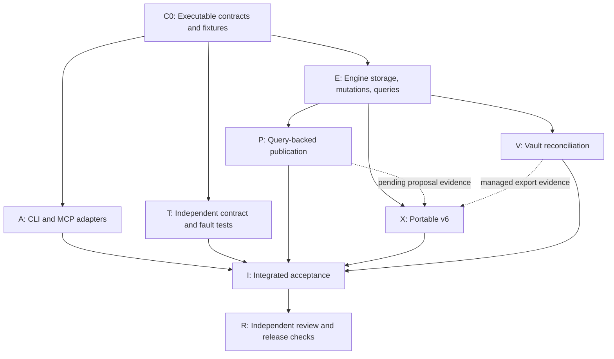

# Owner-defined facets: engine and interface specification

Status: C0 executable contract kit implemented; stage-one runtime implementation pending

Date: 2026-10-13

Authority: [ADR 0020](../architecture/decisions/0020-independent-owner-defined-facets.md)
and [issue #78](https://github.com/cbolden15/open-brain/issues/78).

## Scope and implementation baseline

This specification defines the first facet implementation, including its engine contracts,
CLI/MCP surfaces, publication bindings, Portable representation, and managed-vault reconciliation.
The accepted architecture is independent facets alongside spaces. No built-in dimensions,
automatic classification, recursive synthesis from canonical pages, general query language,
space conversion, background service, or new network path is included.

The original implementation baseline was `dd4d880`. PR79 reconciliation advances the
compatibility floor over main `621161ad48bc8fcfa64966c7a618c18cc72b660a`:

| Surface | Current implementation | Facet target |
|---|---|---|
| Local state | `PHASE1_STATE_SCHEMA_VERSION = 14` | Schema 15 |
| Runtime sessions | `RUNTIME_SESSION_VERSION = 9` | Session 10, required by schema 15 |
| Portable | v9 export and clean import; standalone v4 import refused | Portable v10 export and clean import |
| Review bindings | Version 3 full-page and version 4 patch bindings | Version 5 for facet-query full-page proposals |
| Facet wire contracts | Absent | `dto_version: 1`, closed shapes below |

These next version numbers are assigned against this baseline. If another feature takes one
before implementation merges, renumber the affected contract and fixtures together. Do not reuse
a version for different bytes or silently change historical schema catalogs.

| Existing source seam | Required integration |
|---|---|
| `engine/local_schema.py`, `engine/local_schema_catalog.py`, app `services/local_runtime_session.py` | Migration, shape validation, and exclusive admission |
| `engine/source_schema.py`, `engine/source_store.py`, `engine/sources.py` | Resolve proven logical sources and current heads |
| `engine/t03_contracts.py`, `engine/retrieval.py`, `engine/cursors.py` | Effective authority, record projection, root-bound cursors |
| `engine/review_bound.py`, `portable/review_binding.py`, `engine/review.py` | New binding discriminator, source eligibility, decision and publication validation |
| `engine/portability.py`, `engine/portable_v5_evidence.py`, `engine/portable_v5_restore.py` | Versioned export, staged restore, semantic audit, replay |
| `engine/managed_workspace.py`, `engine/managed_portability.py` | Separate facet projection from content revision evidence |
| App `services/local_mcp.py`, `services/t03_adapters.py`, `services/review_publication.py` | Grant-filtered dispatch, limits, CLI/MCP adaptation |

Engine paths above are relative to `packages/engine/src/open_brain_engine/`; app paths are relative
to `packages/app/src/open_brain/`. They identify existing code. New modules named below are proposed.
The engine must not import app, connectors, or desktop packages.

## Identity and vocabulary

Use typed opaque UUIDv4 IDs with prefixes `facetdim_`, `facetval_`, `facetquery_`, and `facetevent_`.
IDs never depend on names, paths, or timestamps. The owning Brain is implicit in the admitted
engine context and explicit in portable evidence. A value has exactly one immutable dimension ID.

Dimension, value, and saved-query names are NFC-normalized, stripped of surrounding whitespace,
nonblank, at most 120 Unicode characters, and reject control characters. Their uniqueness keys
are the NFC-normalized casefold of that name. Dimension names are unique Brain-wide, value names within
their dimension, and query names Brain-wide. Archived names remain reserved. Renaming releases
the previous name for reuse; old previews resolve through retained IDs and mappings, never by
looking up a historical label as though it were current.

Name equality is an input-resolution rule only. Every engine mutation, saved query, event, and
publication binding uses IDs. CLI name resolution fails if it is missing or ambiguous, then sends
the resolved ID and expected version. MCP requests use IDs directly. Preserve existing privacy
projection for public strings and frame names and returned text as untrusted data.

There is no delete, move-value-to-another-dimension, merge, or unarchive operation in this
increment. Archive is one-way in this interface. It retains names, assignments, and history.
An archived dimension makes all its values effectively archived, without rewriting each value's
own archived flag. No new values may be created within it. Archived values can remain assigned,
be removed, and participate in saved queries; no new assignment to one is admitted.

## Record identity and classification time

`FacetSubject` is exactly `{kind: "source"|"canonical", id: string}`. A source subject uses the
existing `source_id` from `logical_sources`. A canonical subject uses its existing `page_id`.
No additional record-identity layer is introduced.

Public record lookup accepts the existing record anchor: a capture ID resolves to its proven
source; a page ID resolves to its page. Resolve under current authority before returning subject,
head, version, or membership details. An unknown or unauthorized anchor returns `not_found`.
Ungrouped legacy captures retain independent logical sources. Text, URL equality, and accepted
duplicate/supersedes relationships do not establish source lineage or copy facets.

Assignments follow the logical source through proven successors and follow a canonical page
through publication revisions. A new content revision does not append a classification event.
Current queries evaluate current eligible source heads and current eligible canonical revisions.
Facet classification does not remove any independent routing or intake restriction.

Classification has its own event sequence. History reads can request an `as_of_sequence`; the
result is classification at that event boundary, under current read authority. A content revision
does not uniquely determine classification: multiple facet changes can occur between content
revisions. Do not fabricate a historical assignment by applying today's state to yesterday's bytes.

## Storage, versions, and mutation transactions

Implement `FacetTasks` under a new engine `facets.py`, with immutable request/response values
and closed parsing in `facet_contracts.py` and a matching `facet_schema.json`. Add `facets` to
`EngineTaskSet`; app adapters receive named callables and trusted `EffectiveAuthority` values.

The tables below are the normative logical schema. JSON columns hold strict canonical JSON;
`timestamps` means `created_at` and `updated_at`, using the existing canonical UTC timestamp format.
All foreign references must be validated; a polymorphic subject reference requires explicit
source/page existence checks within the same transaction. Use the current private SQLite store.

| Table | Keys and retained fields |
|---|---|
| `facet_dimensions` | `dimension_id` PK; `name`, `name_key` UNIQUE, `archived`, `version >= 1`, `created_at`, `updated_at` |
| `facet_values` | `value_id` PK; `dimension_id` FK, `name`, `name_key`, `archived`, `version >= 1`, timestamps; UNIQUE `(dimension_id, name_key)` |
| `facet_subject_versions` | PK `(subject_kind, subject_id)`; `version >= 0`; absent row means version 0 |
| `facet_assignments` | PK `(subject_kind, subject_id, value_id)`; value FK, composite subject-version FK; `present`, `membership_version >= 1`, `last_event_sequence`; retain removed rows |
| `facet_queries` | `query_id` PK; `name`, `name_key` UNIQUE, `selector_json`, `archived`, `version >= 1`, `selection_version >= 1`, timestamps |
| `facet_page_queries` | `page_id` PK, `query_id` FK, `version >= 1`; attachment is explicit and independent of page assignments |
| `facet_events` | `event_id` PK, `sequence` UNIQUE positive integer, `operation_id` UNIQUE, `actor_id`, `recorded_at`, `kind`, `event_json` |
| `facet_operations` | `operation_id` PK, `principal_id`, `request_sha256`, `request_json`, `receipt_json`, nullable `event_id` FK |

Catalogue entity versions advance only when that entity changes. A subject version advances once
for an effective assignment patch, regardless of how many values it changes. A membership version
advances whenever that subject/value pair changes presence. Removing and reassigning a value
therefore changes its version even if it ends up present again. That prevents an old proposal
from accepting a remove-and-restore cycle as unchanged evidence.

Renaming or archiving a catalogue entity does not increment every subject or membership version.
Archiving preserves assignments and query meaning. A query's edit version changes on rename,
selector change, or archive; its `selection_version` changes only when the selector changes.
Approval binds that selection version and requires an active query, so a query display rename
does not invalidate a draft. A page-query attachment has its own version; no content revision is
generated. Catalogue entities and queries start at version 1. Membership versions start at 1;
the first effective subject assignment patch changes subject version 0 to 1.

Each effective mutation uses one transaction for request admission, expected-version checks,
event append, current-state projection, operation receipt, and retrieval-generation change.
Acquire the existing shared writer fence before the store transaction so Portable export's
exclusive fence sees a consistent cut. Advance the existing retrieval generation conservatively
on every effective facet mutation; query cursors may become stale after unrelated facet changes.
Publication approval uses precise bindings and never compares this global generation.

An event has exactly `schema_version:1,brain_id,event_id,actor_id,operation_id,sequence,recorded_at,
kind,changes`. Each change is exactly `{entity:{kind,id},before:null|object,after:object}` with
entity kind `dimension|value|subject|assignment|query|attachment`. For an assignment, `id` is
the object `{subject_kind,subject_id,value_id}`; a subject uses `{kind,id}`; other IDs are strings.
Before/after objects contain the complete corresponding table row's semantic fields, including
versions and timestamps, excluding derived name keys. Canonical serialization derives name keys
from names on replay. Create has null before-state; removed assignments use `present:false`
after-state. An assignment patch records the subject-version change followed by membership changes.
Event kinds are `dimension.create|rename|archive`,
`value.create|rename|archive`, `assignment.patch`, `query.create|update|archive`, and
`query.attach`. Within a multi-value patch, order membership changes by value ID. Events are immutable;
current tables are validated projections of their replay. Keep source and canonical bytes intact.

Mutation admission order is significant:

1. Validate the closed request and current operation authority; resolve and authorize referenced
   records and catalogue scope without disclosing denied identities.
2. Look up the operation ID in this Brain's facet-operation namespace, shared by CLI and MCP.
   An identical normalized request from the same principal returns its original receipt before
   checking old expected versions. Divergent reuse returns `idempotency_conflict`.
3. For a new operation, validate expected versions and referenced current heads. Check archive
   eligibility only for newly added memberships. Stale expectations conflict even for a no-op.
4. Apply the whole mutation or none. Persist one event only if semantic state changes. A fresh
   valid no-op persists an `unchanged` receipt without an event, version increment, or generation
   increment. Removing an absent assignment and adding an existing one are no-ops.
5. Commit the receipt with the mutation. A lost response is recovered through the same operation
   ID. Recheck current authority on every replay; a receipt never grants historical access.

Operation IDs are 1–128 nonblank characters with no control characters. Request hashing includes
the method, normalized arguments, expected versions, and stable IDs, but excludes transport request
IDs, session IDs, and response-budget state. Effective principal binding prevents cross-principal
receipt replay. A later head or membership change does not rewrite a previous success receipt.
Responses never attach fresh current state to an old mutation receipt; use an explicit read.

## Exact-value queries and pagination

`FacetSelector` has exactly these fields after default expansion:

```json
{
  "all_value_ids": ["facetval_00000000-0000-4000-8000-000000000001"],
  "space_ids": [],
  "payload_families": [],
  "record_types": ["source", "canonical"]
}
```

Normalize each array to sorted unique IDs or enum values. Require 1–32 distinct values; an empty
conjunction is invalid. All value predicates are AND, including within one dimension. Within
each optional filter array, values are OR; filter families are AND. Empty optional arrays mean
no additional restriction. Record types are `source|canonical`; payload families use the existing
retrieval vocabulary. Requested spaces intersect current authority and never broaden it.

Source rows resolve to one current head per logical source. Canonical rows resolve to one current
page revision. Use the existing public record projector and eligibility rules, including all
canonical provenance members. Do not expose raw bytes, hidden match counts, skipped-record counts,
or IDs from denied rows. A source payload-family filter is inapplicable to canonical records, so
a nonempty payload-family filter excludes canonical rows. Exact query lookup is independent of
lexical search and does not load an embedding model.

Sort ascending by immutable logical-record acceptance time and then stable subject ID, with
subject kind as the final tie-breaker. For a source, acceptance time is that of its first proven
revision; for a page, it is its first retained publication. A new content revision does not move
the logical record in the ordering. Each result includes both stable subject identity and the
current `RecordSummary`, whose source record ID may change as its head changes.

Use keyset pagination and the existing root-bound `CursorStore`: 15-minute expiry and the current
2,000-handle cap. Cursor state binds method, normalized selector digest, saved query ID/version
when used, limit, ordering version, last key, Brain/root incarnation, principal and scope digest,
authorization generation, retrieval generation, and projection policy. Reject a changed input,
expired/tampered cursor, relocated Brain, or changed generation using existing cursor-error
semantics. Revalidate authority and eligible rows for every page. Return no total count.

Catalogue lists sort by stable entity ID; history lists by ascending event sequence. They use the
same bounded envelope and cursor custody with method-specific bindings. Mutation receipts and
history event sequence are semantic state; cursors and raw generation values are operational.

## Engine and wire operations

All request objects contain `dto_version:1`; unknown or duplicate keys are invalid. Reject invalid
UTF-8, NaN/infinity, booleans as integers, fractional/exponent integer tokens, negative versions,
and integers above `2^53-1`. Defaults below are expanded before hashing. Nullable fields shown
in a shape are always present in responses. Authority, owner flags, raw paths, SQL, and scope
overrides are never accepted from request arguments.

Common abbreviations in the tables are normative:

| Type | Exact fields or constraints |
|---|---|
| `Page` input | `limit=50` (1–100), `cursor=null` |
| `Write` input | `operation_id`, `expected_version` (integer; 0 for create) |
| `Dimension` | `dimension_id,name,archived,version` |
| `Value` | `value_id,dimension_id,name,archived,effective_archived,version` |
| `SavedQuery` | `query_id,name,selector,archived,version,selection_version` |
| `Membership` | `value_id,membership_version`; current assignment reads include present pairs only |
| `AssignmentState` | `subject,record_id,revision_id,version,memberships` |
| `Attachment` | `page_id,query_id,version` |
| `HistoricalRecordState` | `subject,version,memberships,attachment:null\|Attachment`; source attachment is always null |
| `FacetResult` | `subject,record,classification_version`; `record` is the existing projected `RecordSummary` |
| `Receipt` | `status:"applied"\|"unchanged",operation_id,subject_id,version,event_id:null\|string` |

All successful facet envelopes include `dto_version:1`. Entity reads return
`{status:"ok",dto_version:1,item:<type>}`. Mutations return the `Receipt` fields plus `dto_version`;
`subject_id` is the affected catalogue ID, source ID, or page ID. A replay returns the same logical
receipt, without adding a replay flag. Lists return
`{status:"ok",dto_version:1,items:[],next_cursor:null|string,complete:boolean}`. Facet-query pages
use `items:FacetResult[]`. Public history returns projected changes, never raw stored request
arguments or receipt digests.

| Engine method and wire operation | Additional request fields | Response and semantics |
|---|---|---|
| `dimensions_list` / `facet.dimension.list` | `Page`, `include_archived=false` | `Dimension[]` |
| `dimension_create` / `facet.dimension.create` | `Write`, `name` | Create a generated ID at version 1 |
| `dimension_rename` / `facet.dimension.rename` | `Write`, `dimension_id,name` | Rename only |
| `dimension_archive` / `facet.dimension.archive` | `Write`, `dimension_id` | Preserve descendants and assignments |
| `values_list` / `facet.value.list` | `Page`, `dimension_id,include_archived=false` | `Value[]`; default excludes effectively archived values |
| `value_create` / `facet.value.create` | `Write`, `dimension_id,expected_dimension_version,name` | Validate active parent; new value version 1 |
| `value_rename` / `facet.value.rename` | `Write`, `value_id,name` | Stable dimension and value IDs |
| `value_archive` / `facet.value.archive` | `Write`, `value_id` | Retain all current memberships |
| `assignments_get` / `facet.assignment.get` | `record_id` | `AssignmentState` under current authority |
| `assignments_patch` / `facet.assignment.patch` | `Write`, `record_id,expected_revision_id,add_value_ids:[],remove_value_ids:[]` | Atomic patch; disjoint arrays of at most 128 values each and 128 resulting present memberships |
| `queries_list` / `facet.query.list` | `Page`, `include_archived=false` | `SavedQuery[]` visible under query scope rules |
| `query_get` / `facet.query.get` | `query_id` | `SavedQuery` |
| `query_create` / `facet.query.create` | `Write`, `name,selector` | Generated query ID at version 1 |
| `query_update` / `facet.query.update` | `Write`, `query_id,name,selector` | Complete replacement of editable query fields |
| `query_archive` / `facet.query.archive` | `Write`, `query_id` | No new page attachment or proposals; retained history remains readable |
| `query_attach` / `facet.query.attach` | `Write`, `page_id,expected_revision_id,query_id,expected_query_version` | Create/replace attachment; `expected_version` is attachment version, 0 when absent |
| `query_attachment_get` / `facet.query.attachment.get` | `page_id` | `Attachment` or `item:null` if none, after authorizing page |
| `query_page` / `facet.query.page` | `Page`, `selector` or `query_id,expected_query_version` | Exactly one query form; saved archived queries remain runnable |
| `history_list` / `facet.history.list` | `Page`, `subject:{kind,id}`, `as_of_sequence=null` | Projected event entries for `dimension\|value\|query\|source\|canonical`; sequence cutoff inclusive |
| `history_state` / `facet.history.state` | Same subject, required `as_of_sequence` | Replayed state at that cutoff; absent-before-creation is `item:null` |

Every engine method accepts the corresponding typed request and keyword-only
`authority: EffectiveAuthority`. `history_list` entries contain
`event_id,sequence,recorded_at,actor_id,kind,changes`; include only changes authorized for the
requested subject. `history_state` returns exactly
`{status:"ok",dto_version:1,as_of_sequence,item:null|Dimension|Value|SavedQuery|HistoricalRecordState}`.
Record state includes its assignment version and, for a page, attachment at the cutoff. It reports
no fabricated historical content revision. A known record with no facet events has version 0,
empty memberships, and null attachment; catalogue entities not yet created at the cutoff return
null. Historical removed memberships remain visible in events. Effective archive state at the
cutoff is derived from the parent state at that cutoff. No history operation restores old state.

Create operations use `expected_version:0`. Assignment patches validate current head identity
in addition to subject version. Existing catalogue IDs in patches are required; patch never
creates values. An empty patch is invalid. A no-op adding an already present archived value
remains allowed after version validation because it introduces no new membership.
Renaming archived dimensions/values is allowed with the proper version and catalogue grant.
Updating an archived saved query is refused; repeating its archive with a current expected version
is an unchanged operation. Query archive retains attachments and runnable historical organization,
but blocks new proposals and attachments.

Catalogue reads intentionally disclose the owner's vocabulary to sessions granted `facet-read`;
they do not disclose record counts or memberships. Saved-query reads require every explicit space
filter to be permitted by the session; apply that rule to query writes and attachments as well.
Running a query still intersects all current record authority. A denied saved-query definition is
`not_found`, not a partially rewritten query.

For example, a source at assignment version 2 with value A present at membership version 1
accepts an assignment patch removing A and becomes assignment version 3, membership version 2.
Replaying that operation with its original expected version 2 returns its original version-3
receipt. A fresh operation with expected version 2 conflicts. Reassigning A with expected version 3
creates assignment version 4 and membership version 3; a proposal bound to membership version 1
must still conflict even though A is present again.

The following synthetic request is the complete body for `facet.assignment.patch`; the method
name belongs to the transport envelope, not the request body:

```json
{
  "dto_version": 1,
  "operation_id": "fixture-apollo-assign-1",
  "expected_version": 0,
  "record_id": "capture_00000000-0000-4000-8000-000000000002",
  "expected_revision_id": "capture_00000000-0000-4000-8000-000000000002",
  "add_value_ids": ["facetval_00000000-0000-4000-8000-000000000001"],
  "remove_value_ids": []
}
```

If those fixture IDs are eligible and the subject is unclassified, a success has this shape:

```json
{
  "status": "applied",
  "dto_version": 1,
  "operation_id": "fixture-apollo-assign-1",
  "subject_id": "source_00000000-0000-4000-8000-000000000003",
  "version": 1,
  "event_id": "facetevent_00000000-0000-4000-8000-000000000004"
}
```

## CLI and MCP mapping

These commands and tools are new interface contracts, not claims of installed availability.
Implement app adaptation in a dedicated `services/facets.py` and wire it into existing entrypoints.
JSON output is the engine envelope; human output projects safe strings and clearly identifies IDs
and versions. CLI mutations may generate an operation ID, but must print the effective ID.

| CLI under `open-brain facet` | MCP tool | Required non-owner capabilities |
|---|---|---|
| `dimension list`, `value list --dimension ID` | `brain_facet_dimension_list`, `brain_facet_value_list` | `facet-read` |
| `dimension create NAME`, `dimension rename ID NAME`, `dimension archive ID` | `brain_facet_dimension_create`, `brain_facet_dimension_rename`, `brain_facet_dimension_archive` | `facet-catalog-write` |
| `value create --dimension ID NAME`, `value rename ID NAME`, `value archive ID` | `brain_facet_value_create`, `brain_facet_value_rename`, `brain_facet_value_archive` | `facet-catalog-write` |
| `assignment show RECORD_ID` | `brain_facet_assignment_get` | `facet-read` and current record eligibility |
| `assignment patch RECORD_ID --add ID --remove ID` | `brain_facet_assignment_patch` | `facet-assign` and current record eligibility |
| `query list`, `query show ID`, `query attachment PAGE_ID` | `brain_facet_query_list`, `brain_facet_query_get`, `brain_facet_query_attachment_get` | `facet-read` and applicable scope |
| `query create NAME --selector-file PATH`, `query update ID --name NAME --selector-file PATH`, `query archive ID` | `brain_facet_query_create`, `brain_facet_query_update`, `brain_facet_query_archive` | `facet-query-write` and applicable scope |
| `query attach ID --page-id PAGE_ID` | `brain_facet_query_attach` | `facet-query-write` and current page eligibility |
| `query run ID`, `query run --selector-file PATH` | `brain_facet_query_page` | `facet-read` plus existing `search` |
| `history list --kind KIND --id ID`, `history state --kind KIND --id ID --as-of-sequence N` | `brain_facet_history_list`, `brain_facet_history_state` | `facet-read` plus existing `history-read` |

All mutation flags include `--operation-id`, `--expected-version`, and the applicable
`--expected-revision-id`, `--expected-query-version`, or `--expected-dimension-version`.
`--add`/`--remove` repeat. Lists accept `--limit`, `--cursor`, and their documented filters.
Saved-query runs also require `--expected-query-version`; ad hoc runs supply the selector only.
`--selector-file -` accepts stdin; paths are app-owned file input, never an engine wire field.
The CLI may resolve names only through authorized reads; it never silently fetches a newer
version and overwrites an explicitly stale expectation.

Expose independent, default-off setup flags `--allow-facet-read`, `--allow-facet-catalog-write`,
`--allow-facet-assign`, and `--allow-facet-query-write`. Catalogue-write authorizes the Brain-wide
vocabulary; assignment-write does not. Write grants alone return narrow receipts and do not imply
catalogue, content, history, search, or review reads. Existing grants do not imply any facet grant.
Authority is constructed by trusted session setup and revalidated by the engine.

Advertise operations only when the implementation callable and every required capability are
present. Reject direct calls to unadvertised methods before handler effects. Extend agent setup,
configuration validation, `contract.describe`, MCP discovery, and negotiated bridge registries
together. Desktop/plugin feature UI is outside stage one; bridge adapters must use the same closed
contracts when implemented. Existing capture/search configuration stays valid without facet grants.

## Limits, errors, and response admission

Facet methods accept at most 65,536 encoded request bytes, except facet-query review proposals,
which allow 1 MiB to accommodate the existing 64 KiB Markdown limit and JSON escaping;
the encoded request limit still takes precedence. All transport wrappers count toward bounds.

| Resource | Limit |
|---|---|
| List page | 1–100 items; default 50; 250,000 encoded bytes |
| Single facet read/history state | 1 MiB encoded response; explicit `response_too_large` if it cannot fit |
| Mutation receipt | 4 KiB encoded response, reserved before executing effects |
| Facet metadata reads per session | 500 calls, 16 MiB responses |
| Facet writes per session | 500 calls across catalogue, assignment, query writes; 16 MiB responses |
| Query result pages | Charge existing negotiated search/content budget: 500 calls, 16 MiB |
| Facet history | Charge existing history budget: 500 calls, 16 MiB |
| Review | Retain 500 reads, 100 proposals, 100 decisions, and existing 16 MiB review-response budget |

Route each operation to exactly one call bucket. Count admitted attempts, including retries and
backend failures; reject exhaustion before effects. Reserve the fully wrapped worst-case narrow
receipt against both remaining bytes and transport capacity before mutations. Charge actual
encoded response bytes and release unused reservation. A byte-limited list returns a continuation;
if one item cannot fit, return `response_too_large` without advancing past it. Never truncate an
event, assignment set, preview, or inspected proposal and label it complete.

Engine failures carry the following closed facet codes. CLI JSON failures are exactly
`{status:"error",dto_version:1,code:<code>}`; MCP and bridge use their existing transport failure
wrapper around the same code. Include
no raw exception, local path, request digest, private scope, or inaccessible identity in details.

| Code | Meaning |
|---|---|
| `invalid_arguments`, `name_conflict` | Closed grammar or normalized-name uniqueness failure |
| `not_found`, `unsupported_capability` | Missing/denied entity or absent operation authority |
| `version_conflict`, `revision_changed` | Expected facet state or current content head differs |
| `idempotency_conflict` | Operation ID reused with a different canonical request/principal |
| `facet_archived`, `query_archived` | Newly assigning an effectively archived value, or mutating/attaching/proposing from an archived query |
| `cursor_stale`, `cursor_invalid` | Valid but outdated continuation, or invalid/expired custody |
| `limit_exceeded`, `response_too_large` | Input/cardinality/session bound or unrepresentable complete response |
| `review_conflict`, `preview_stale`, `projection_conflict` | Bound evidence, reconciliation preview, or managed-file conflict |
| `operation_pending` | Existing bounded contention/recovery path; retry using the same operation ID |

Scope errors precede version, archive, and conflict details. Current authority is required for
success-receipt replay too. Catalogue name conflicts are observable only to catalogue writers,
whose grant explicitly includes that vocabulary. CLI grammar failures exit 2, domain failures 1,
and transient database contention 75, matching the current CLI conventions.

## Query-backed review and publication

Add `review.propose_from_facet_query` and MCP `brain_review_propose_from_facet_query` with CLI
`open-brain review propose --facet-query-id ID`. This mode is mutually exclusive with explicit
`--capture-id` and patch proposals. Its request is exactly
`dto_version,operation_id,query_id,expected_query_version,target_page_id:null|string,
expected_page_revision_id:null|string,destination_space_id:null|string,title,markdown`.
New pages require a destination and null target/expected revision. Updates require the target's
current revision; destination is null and resolves to its retained space. Title is 1–200 characters;
Markdown retains the existing 64 KiB UTF-8 limit.

Require `facet-read`, `search`, and `review-propose`, plus current source and destination authority.
Creating/replacing a page-query attachment also requires `facet-query-write`. For updates, the
target must already be attached to that query; changing attachments is a separate explicit write.
For creates, reserve the intended attachment in proposal evidence and materialize it only on
approval. Do not assign any facet values to the page implicitly. The owner CLI has its
existing explicit owner authority. Subsequent inspection and decision use existing review tools;
they validate the new binding and current evidence without requiring proposal grants again.
The proposal response is the existing narrow review creation receipt, with the reserved page ID,
proposal ID, and effective operation/retry ID; inspection returns the complete projected draft and
version-5 selection evidence. Preserve the existing review response envelope and source/draft
size limits. Existing review approval is the explicit authority for materializing the attachment
bound into a new-page proposal; it does not confer general query-write permission.

Evaluate the saved selector's source records only in one consistent authorization/data snapshot.
Ignore canonical matches for evidence selection even if the selector searches both record types;
a canonical-only selector is invalid for publication. Require the complete selected set to have
1–32 records. Read at most 33 eligible matches to detect overflow and refuse `limit_exceeded`;
do not silently take the first page. A zero-match query fails `invalid_arguments`. Query narrowing
is explicit. Sources can be unassigned or in different spaces if individually eligible.
Derive output privacy and trust from the complete evidence under the current publication policy.
A destination space never lowers source privacy. Refuse an unsupported combination rather than
copying a representative source's policy or using a hard-coded work/public default.

New binding version 5 has the existing version-3 full-page fields plus `selection_kind:"facet"`,
`destination_space_id`, `query_id`, `query_version`, `query_selection_version`, `selector`,
`attachment_version` (0 on create),
and `facet_source_states`. Each selected source state binds `source_id`, exact `capture_id`,
current head version, and sorted pairs of selected query value IDs and membership versions.
Retain existing source byte hashes, route IDs and spaces for all provenance members. The review
digest covers all these fields and the exact proposed bytes. Catalogue display names, global
retrieval generation, and unrelated memberships are excluded from semantic approval bindings.

For updates, retain cumulative ordered provenance: prior exact capture IDs first, followed by
new selected IDs in query order, deduplicated by capture ID. Enforce the existing 32-member limit
on the union too. Historical provenance members need integrity and current authorization, not
current query membership or current-head status; new selected evidence must satisfy both.
Source-head changes mark previously published evidence stale through existing behavior, and
require a new proposal when they affect pending selected evidence.

Approval revalidates selected heads, membership versions/presence, query selection version, attachment,
destination, routes, privacy/authority, inherited evidence, target revision, and stored draft.
Removing and restoring a selected membership conflicts. A newly matching record, an unrelated
assignment, or a dimension/value/query display rename does not conflict. The captured query edit
version remains audit evidence, not a comparison against the current edit version. Archive of a
dimension/value preserves query membership and therefore does not alone invalidate approval;
archiving the saved query or changing its selector does. A source route change still conflicts
through the retained route binding.

Use the existing review decision/publication stage machine and filesystem recovery; do not
claim that a SQLite transaction alone makes Markdown publication atomic. A publication reserves
one page revision, never exclusive membership of the selected captures. Shared evidence across
facet pages is allowed. Keep existing capture-routing restrictions and old manual proposal checks.
When a create publication commits its page head, commit the bound page-query attachment and one
`query.attach` event in that same stage transaction. Derive a deterministic internal operation ID
from the publication ID and persist its receipt. Recovery cannot append another attachment event.
Its canonical semantic request binds the page, query, selector version, and publication ID; it is
admitted only by the publication stage machine, never as a separate public authority bypass.

Implementation must branch by binding version at every same-space validation site, including
Portable validation and restore. Version 5 verifies the explicit destination independently of
each source route. Old binding versions retain their exact validation. Do not loosen `_one_space`
globally or derive a facet page's destination from the first capture. Proposal serialization,
publication validation, provenance projection, and index reconstruction must all agree on this.

## Portable v6 and migration

Schema 11 adds the facet tables, projection bookkeeping, and version-5 binding support without
editing retained source/canonical/history bytes. Perform the migration under exclusive runtime
admission. New tables start empty; no dimensions, values, or assignments are inferred from spaces.
Supported older local states follow their existing guarded migration chain to schema 10 before
the facet transition; invalid or unknown states are never admitted by skipping earlier checks.
Set compatibility to schema 15/runtime 10 in the same committed schema transition. Validate ledger
checksums and expected shape. Older sessions block migration, and older binaries refuse schema 15.
There is no automatic downgrade; a failed pre-commit migration leaves schema 10 intact. A failure
after commit is reported as committed-upgrade recovery, never as a successful rollback.

Portable v6 keeps the existing evidence formats and adds three required canonical JSON sidecars:

| Path | Content |
|---|---|
| `history/facets/events-v1.json` | `{schema_version:1,brain_id,events:[...]}` ordered by event sequence |
| `history/facets/operations-v1.json` | `{schema_version:1,brain_id,operations:[...]}` ordered by operation ID; exact request/receipt bytes and principal bindings |
| `content/facets/state-v1.json` | `{schema_version:1,brain_id,dimensions:[],values:[],subjects:[],assignments:[],queries:[],page_queries:[]}` sorted by stable keys, including removed membership versions |

The state sidecar is a replay assertion. Import must derive it from events and validate exact
agreement, not trust two copies of state independently. Operation records preserve effective
and no-op receipts; effective operations reference their event. Validate request digests, actor
and Brain bindings, before/after version continuity, IDs, name uniqueness, membership versions,
referenced source/page existence, and query references. IDs and sequences survive import unchanged.
Set the next event sequence above the greatest retained sequence. Catalogue vocabulary and facet
history obey the existing owner-authorized full Portable export boundary.

Add version-5 proposal bindings and pending page attachments to the v6 catalog. Keep their exact
bytes through import, including rejected and pending proposals. Pending attachment intent belongs
to proposal evidence, not `page_queries` until publication. Reconstruction preserves many-to-many
source provenance and each page's independent destination. Import followed by approval must work
for a valid pending proposal and reject evidence that was already stale in the archive.

V6 manifests use schema/layout version 6 and contract version `"6"`, with a new frozen catalog
digest and compatibility `{minimum_contract_version:"1",maximum_contract_version:"6"}`.
This retains the current manifest convention; it does not assert that an older reader can accept
v6 evidence. Dispatch by actual schema/layout/catalog support. V6 support does not enable standalone
v4 restore. A v6 archive is never passed to a v5 parser or exported as v5 by dropping facets.
Preserve existing v1–v3/v5 imports, migrating the restored Brain through current guarded admission.
An imported legacy archive has an empty facet ledger. Use local ready-record version 3 for v6, with
facet semantic-state and operation-receipt coverage, without altering v5 retry verification.

Export holds the existing canonical fence and a single SQLite read snapshot. Pending/quarantined
ingress still blocks export. Restore validates a pinned snapshot, creates a hidden sibling stage,
restores durable evidence, replays facets, derives queries/search state, checks semantic equality,
reopens, rechecks, and only then promotes. Repeated import verifies the complete promoted state
before returning a duplicate receipt. Faults before promotion leave no destination; after promotion
they leave a complete destination verifiable by the original import operation.

Facet indexes, generated facet frontmatter, local reconciliation previews, cursor keys, generation
numbers, local workspace paths, and projection checksums are not authoritative Portable content. Integrate with
managed-evidence export so generated fields cannot leak into retained content snapshots. User
modifications to generated notes cannot be silently discarded: export must refuse unresolved
projection conflicts until the owner preserves or resolves the edits. Rebuild clean views after
import; no local preview token survives a move or restore.

## Managed-vault projection and reconciliation

Project facets only onto existing managed record files with proven source/page identity; never
create a duplicate source note merely to carry metadata. Captures without a managed file remain
classifiable through CLI/MCP and query results. Frontmatter uses the ADR's reserved `facets`
mapping and YAML arrays, sorted by dimension name key/ID and value name key/ID. Use safe YAML
serialization with quoted strings where needed. Retain ID-to-rendered-name mappings in local
projection bookkeeping, never infer identity from a filename or today's display name.

Store local `facet_projection_state` keyed by workspace and managed file identity, with its
subject, content-revision identity, emitted facet subtree, ID/name mapping, and materialized
file digest. Index entries use a separate file-kind marker so they cannot enter source ingestion,
canonical publication, graph evidence, or managed content history as owner-authored notes.
An existing unregistered `facets` property is owner content, not generated metadata. Preserve it
and report `projection_conflict`; projection registration cannot silently claim or strip it.
The owner must resolve that collision through the existing content workflow before registration.

Extend the managed parser/observer with a projection-aware path. Only for a registered projection
may it separate the generated facet subtree from canonical content. Verify all remaining content
through the existing revision/conflict path; never globally ignore arbitrary frontmatter changes.
A facet-only change creates an observation, not a content revision. Body or other frontmatter
changes continue through the existing content workflow. Combined edits require both workflows;
facet reconciliation never approves or overwrites the body edit.

Add owner-local `facet.vault.preview` and `facet.vault.apply` engine operations and CLI
`open-brain facet vault preview --workspace-id ID --record-id ID` and
`open-brain facet vault apply --preview-id ID --operation-id ID`.
Preview is read-only with respect to semantic classification; it may persist local preview custody.
No MCP tools expose filesystem reconciliation in this increment.

`preview` request contains `dto_version,workspace_id,record_id`. Its response is
`{status:"ok",dto_version:1,preview_id,subject,expected_version,add_value_ids:[],remove_value_ids:[],
conflicts:[],expires_at}`. Conflict entries are exactly `{code,value_id:null|string}`; codes are
`unknown_name`, `ambiguous_name`, `archived_addition`, `content_changed`, `projection_changed`,
and `invalid_frontmatter`. Unknown/ambiguous names use null IDs. Preview never creates vocabulary.
Use the previous ID/name mapping to interpret unchanged historical labels, current authorized
vocabulary for new labels, and report ambiguity if either could denote a different identity.

The preview binds workspace/root identity, registered file identity and path, current full file
digest, previous generated facet subtree and mapping, classification version, content revision,
resolved IDs, relevant catalogue versions, and current authority. Expire after 15 minutes. Missing
`facets` is a proposed removal of all prior projected memberships, explicitly displayed for apply;
observation or refresh alone never performs it. An empty `facets` map has the same preview behavior.

`apply` request is exactly `dto_version,preview_id,operation_id`; response is
`{status:"ok",dto_version:1,receipt:<Receipt>,projection_status:"current"|"refresh_required"}`.
The nested receipt is immutable; projection status is a current operational observation and may
change on a successful replay. Refuse nonempty conflicts or a
changed/expired preview. Revalidate file identity, digest, versions, root confinement, and authority
before atomically committing the assignment patch. A successful retry checks its operation receipt
before preview expiry or file guards, under current authority. A lost preview before any commit
requires a fresh preview. After commit, regenerate through managed recovery; a failed refresh
reports committed assignment with `refresh_required`, never a rolled-back classification.

Vault preview custody and its apply-request-to-semantic-operation mapping are local operational
state. The durable facet operation stores the resolved `facet.assignment.patch` request and exact
receipt, with stable record/value IDs and expected versions, not a preview token, pathname, file
digest, or workspace ID. Keep the local apply mapping through preview expiry so completed local
replays work. After import, old preview-based requests fail `preview_stale`; the preserved semantic
assignment operation can still be replayed through its original typed request under current
authority. Export never presents a local file-approval token as transferable authority.

One preview covers one record, with at most 128 resulting memberships. Apply preserves the body
and non-facet fields byte-for-byte. If a file changes between validation and materialization,
retain the authoritative classification receipt and preserve the edited file as a conflict. Existing
root pinning, no-symlink traversal, staged writes, and interrupted-refresh recovery remain required.

Generate one index at `Facets/<dimension_id>/<value_id>.md`. Its title and links use projected
display names; its path stays stable across rename. Include effectively archived values with an
archive label. Each index lists eligible existing managed records and matching attached canonical
pages, using deduplicated links; records without managed files are not copied into the vault.
Composite pages link to all indexes named by their saved selector. Links are navigation only.
Render under the managed workspace's existing owner authority and exclusion policy, not the
grants of whichever agent last requested a query.

Refresh compares the last generated digest before replacing an index. Preserve owner-modified
indexes and report conflicts. Generate indexes in bounded foreground batches with continuation
and the existing managed recovery mechanism. Facet-only refresh cannot modify a canonical
publication hash, a managed content revision, or inferred knowledge state.

## Acceptance matrix and delivery boundary

The following are required implementation tests, not claims of tests already run. Use synthetic
Brains and fixture vocabulary. The stage-one artifact is complete when every accepted ADR rule
maps to a contract here and all source seams, errors, versions, and delivery gates are explicit.

| ID | Required proof |
|---|---|
| F01 | Names normalize consistently; archived names stay reserved; rename preserves IDs and queries; no built-in vocabulary |
| F02 | Facets follow proven source successors and page revisions; independent equal-text/URL captures never inherit |
| F03 | Assignment changes preserve exact content bytes, provenance, trust, privacy, and revision identity |
| F04 | Archive preserves assignments and queries; new membership is denied; removal and valid no-op are allowed |
| F05 | Stale new writes conflict; identical retries return the original receipt after later state changes; divergent IDs fail |
| F06 | Faults around transaction commit leave either no mutation or one complete event/state/receipt; no double generation advance |
| F07 | Same-dimension AND, duplicate-term normalization, empty-query rejection, exact sorting, and 201-result pagination |
| F08 | Cursor input/scope/generation/expiry/root changes fail; filtered results and counts disclose no denied records |
| F09 | Cross-space and unassigned sources can support a facet page; new destination is explicit; update destination stays fixed |
| F10 | Zero or more than 32 selected sources fails; cumulative provenance overflow fails without partial proposal |
| F11 | Relevant membership removal/reassignment, selected head, route, query, attachment, target, or authority change conflicts |
| F12 | Newly matching records, unrelated assignments, and dimension/value/query display rename do not invalidate an inspected proposal |
| F13 | Shared source evidence supports independent pages; all legacy same-space and patch-binding tests still pass |
| F14 | A query attachment does not assign facets, and a page assignment does not edit its selector |
| F15 | Direct unauthorized MCP calls fail before effects; each grant combination, quota, retry charge, and receipt reservation is exercised |
| F16 | Migration fault injection, old live peers, unknown/newer schemas, bad checksums, and pre/post-commit recovery preserve boundaries |
| F17 | V6 export/import/reopen/query/re-export preserves exact evidence and semantic state; altered events/projections/receipts are rejected |
| F18 | Imported pending facet proposals approve only when still valid; destinations, cumulative members, and shared evidence restore correctly |
| F19 | Existing v1–v3/v5 import paths remain valid; v4 and unsupported future formats remain refused; ingress gate remains enforced |
| F20 | Preview/apply handles rename races, stale files/versions, expiry, missing mappings, archive additions, and missing subtree removals |
| F21 | Facet-only and combined vault edits preserve content identity; modified index notes survive refresh; generated views stay out of evidence |
| F22 | End-to-end synthetic scenario covers classify, revise, query, publish, archive, reconcile, export, import, and fresh query |

## Delivery graph

Execute the accepted behavior through dependency gates. The ADR's five delivery stages remain
coverage milestones, not a requirement to complete each entire stage before starting the next.
C0 is the first implementation task. No implementation task below is complete merely because
this specification or its fixture examples exist.



Solid arrows identify real-engine integration prerequisites; dashed arrows are evidence required
for X's final acceptance, not prerequisites for its preparatory codec work. C0 also supplies the
shared contracts to P, X, and V. After C0, those consumers may prepare isolated codecs, renderers, and tests against
its fixtures before E passes; they cannot claim real-engine completion until E's gate passes.
The coordinator schedules a ready task as soon as a worker slot opens. There is no whole-wave
barrier. Prefer tasks that shorten the engine-to-publication/Portable-to-integration path.

### C0: Executable contract kit

The implementation is documented in [the C0 consumer guide](facet-contract-kit.md), with explicit
file reservations and task inputs in [the task manifest](facet-task-manifest.json). The contract
revision is `facets-c0-v4`; the manifest records the verified revision commit and fixture hash. C0 checks prove interface and synthetic evidence conformance; the
real-engine acceptance gates below passed on the integrated candidate recorded below.

C0 turns this specification into importable protocols, strict parsers, and reusable synthetic
evidence before independent workers implement its consumers. It does not build a generic
orchestration framework or claim working storage, publication, or restore.

| C0 artifact | Required content and ownership |
|---|---|
| Engine contract values and protocols | Implement the proposed `facet_contracts.py` and `facet_schema.json`, with exact method signatures, closed request/response shapes, enums, errors, normalization, defaults, and authority inputs. Define typed publication and vault boundaries as well as basic facet operations. |
| Draft evidence schemas | Cover events, semantic operation receipts, replay state, version-5 review bindings, and every v6 facet sidecar. Retain existing historical schema definitions. The wire schema governs serialization; protocol/type conformance tests detect drift from it. |
| Shared golden fixtures | Add `packages/engine/tests/fixtures/facets/` with fixed synthetic IDs, canonical bytes, and positive/negative cases for rename, archive, retry/no-op, membership remove/restore, query selection versions, publication bindings, and portable replay assertions. |
| Test-only engine fake | Add a protocol-conforming fake under `packages/app/tests/` with explicit configured responses/errors and call recording. It must reject unsupported calls and never report default mutation success. Production code must not import or install it. |
| Contract suite and task manifest | Add `packages/engine/tests/contract/test_facet_contracts.py` and `packages/app/tests/unit/test_facet_adapter_contracts.py`; map F01–F22 to producer and independent test owners, exact task inputs, declared outputs, and verification commands. |

The shared fixture manifest records a contract revision, SHA-256 hashes of its schemas and
fixtures, and expected parse/validation outcomes. Keep it in the fixture directory and record
its exact commit in the workstream ledger. Use deterministic bytes and explicit IDs rather than
regenerating different examples per worker. The fake shares the real request/response types;
tests must exercise the production parser and serializer rather than a second fake wire parser.

C0 passes when both named contract suites execute, positive fixtures parse and round-trip to
their canonical bytes, negative fixtures fail with their specified errors, protocols type-check,
and the fake can drive adapter contract tests without an initialized Brain. Document how each
example maps to an acceptance case. These checks prove interfaces, not real persistence or access
control. Complete the coordinator's required repository checks before declaring the integrated
C0 milestone verified.

C0 output is one verified commit plus its fixture-manifest hash, explicit file-ownership manifest,
and consumer input list. Initial workers branch from that commit; later workers use a verified
integration descendant containing their required inputs. Unimplemented production operations
remain unadvertised and unavailable; no registration may substitute the fake for a missing engine.

### Task inputs and completion gates

Each worker prompt names its input commits, contract revision, absolute worktree path, exclusive
write scope, required acceptance cases, exact verification commands, and output report path.
Module names in this table refer to the source roots established above. The coordinator resolves
them into absolute paths before dispatch.

| Task | Required inputs | Implementation scope and completion evidence |
|---|---|---|
| E: engine | Verified C0 | Own facet storage/tasks, local schema migration, runtime admission, and focused engine tests. Prove F01–F08 and F16 against the real engine; expose tested mutation/query/snapshot seams for consumers. One owner assigns schema 15/runtime 10 changes. |
| A: adapters | Verified C0; E/P for final wiring | Own facet service adapters, CLI argument handling, grant setup, and adapter tests. Develop against the test fake first. Cover DTO/limit/grant cases from F15; final authority and review behavior must pass against real E/P handlers. |
| T: independent tests | Verified C0; real producers as they land | Own separately assigned acceptance/fault test files covering F01–F22. Derive expectations from the ADR and contract fixtures, not implementation details. Deliver the test suite and passing results for available producers; I executes the combined F22 scenario. Missing producers remain tests-ready or blocked, never passed. |
| P: publication | C0 binding fixtures; verified E for integration | Own facet publication logic, `engine/review_bound.py`, applicable `engine/review.py` changes, and `portable/review_binding.py`. Prove F09–F14 and supply real pending/approved/rejected evidence for X's F18 tests. |
| X: portability | C0 evidence fixtures; verified E for integration; P/V evidence for final gate | Own v6 codecs, validation, export, restore, and their tests. Prove F17–F19, including imported pending proposals from P and generated-view exclusion/conflicts from V. Preparatory codec tests do not complete this gate. |
| V: vault | C0 projection contracts; verified E for integration | Own facet projection/reconciliation, `engine/managed_workspace.py`, `engine/managed_portability.py`, and their tests. Prove F20–F21 and give X a tested managed-evidence export seam. |
| I: integration | E/A/T/P/X/V verified outputs at a compatible contract revision | Coordinator composes the real tasks and adapters, executes the complete F01–F22 matrix, and runs the required combined-tree checks. F22 must use the real CLI/engine/export/import path. |
| R: review and release gate | Verified I on the combined candidate | Independent review of replay/durability, authority, publication evidence, and import recovery. Resolve findings, finalize the release catalog, and verify the exact resulting candidate through applicable release checks. |

P and V do not depend on X to produce their native evidence. X consumes those outputs for its
final round-trip checks, so preparation can overlap without a dependency cycle. A may finish
parser/fake-based tests early; its real-handler gate waits for E/P. T can author regression tests
early and hand them to the relevant producer. Keep intentionally failing tests in their assigned
worktree until the matching implementation is integrated; do not skip them or count them as
acceptance. The gate table is authoritative where the compact graph omits an evidence handoff.

### Scheduling and file ownership

Start with one coordinator and at most six concurrent workers, each in an isolated Git worktree.
The owner authorized this increase from three workers on 2026-10-13, after requiring verified C0
as the dispatch gate. Start E, A, T, P, X, and V together. E implements the engine; A develops
adapters against the fake; T authors independent tests. P prepares publication bindings, X prepares
Portable codecs/validation, and V prepares vault rendering/reconciliation concurrently. Their
preparation does not require finished engine storage; their final integration still requires verified
E, and X also requires P/V evidence. A's final wiring requires E/P. The graph's engine arrows are
integration gates, not a prohibition on this preparation.

Use supported separate terminal/session executors when native subagent slots cannot hold all six.
Keep their existing approval and sandbox controls. A terminal session is a worker in the same cap
and ledger, with a recorded session/process identity, worktree, and report path. Reuse sessions with
fresh bounded contracts for dependent stages. At a preparation checkpoint, record tests-ready or
blocked-on-input and release the active slot; resume when the verified input arrives. Independent
review uses a freed slot. Empty reports and running processes never count as successful work.

Reserve one writer per file before dispatch. Worktrees prevent incidental filesystem interference;
they do not resolve competing edits to the same source file. E owns facet engine and migration
helpers; P owns review-binding production/validation; V owns managed-workspace and managed-export
integration. X consumes P/V interfaces and must not edit those files concurrently. T owns separate
test files rather than modifying a producer's focused tests. C0 fixtures and shared contracts
remain coordinator-owned after the initial contract commit.

The coordinator owns shared task composition and final registration, including
`engine/contracts.py`, `engine/local.py`, app `services/local_entrypoints.py`,
`services/local_mcp.py`, local schema/catalog and runtime-session registration, and final Portable
manifest/catalog registration. Adapter workers deliver
their service callables and contract tests; the coordinator wires them through existing registries.
Do not add runtime abstraction layers solely to avoid scheduling shared-file edits. An ownership
transfer is explicit in the ledger and occurs only after the previous writer has stopped.

The workstream ledger records task/dependency status, active and total worker counts, worktree,
base commit, contract revision/hash, reserved files, checkpoints, output commits, verification,
and unresolved findings. Use the workflow-governance limits across all workers and terminals:
at most six active workers plus the coordinator and twelve total dispatch attempts unless a
specific override is recorded. Initial workers were pinned to the verified C0 commit and `facets-c0-v1`.
Current consumers use `facets-c0-v4` and the exact fixture-manifest hash in the task manifest. Later dependency updates identify a
verified integration descendant and invalidate affected checks. A worker's unsupported
success assertion is not completion evidence. Verify commits and reports before consuming them.

### Implementation, repair, and integration loop

1. Assign one bounded slice against a verified input commit and contract revision. Use a
   45-minute checkpoint to return a tested slice or a precise blocker; it is a planning bound,
   not permission to discard unfinished edits or kill a worker during a write.
2. The worker implements and runs its focused tests and applicable static checks. It reports
   status, commit, changed files, contract hash, F-case coverage, exact commands/results, and
   concerns. Reports distinguish fake-based, real-engine, and packaged verification.
3. The coordinator checks the evidence and integrates scoped commits as they pass. Re-run
   affected cross-component tests on the combined commit. A green isolated worktree does not
   prove that the integrated tree passes.
4. Route failures back with the failing command, evidence, and bounded repair scope. After two
   unsuccessful repairs of the same failure, change the hypothesis or reviewer and let the
   coordinator resolve any contract issue. Do not run an unchanged repair loop indefinitely.
5. Run the full repository gate at integrated milestones and final acceptance. Mark dependent
   gates stale when an input contract or relevant source changes; re-run affected checks before
   reporting completion. Integrate local commits only; publishing and pushing require their
   separately authorized delivery step.

Focused worker checks avoid repeated full builds. The coordinator remains responsible for
`make verify` at the C0 and integrated engine milestones and on the final combined candidate.
If another intermediate milestone is reported as verified, run its required repository checks
too. Run expensive native/package checks once per relevant candidate, repeating them when
subsequent changes invalidate that evidence. Never substitute fake-based tests for the real
dispatch, durable state, migration, or restore requirements in F01–F22.

### Contract changes and Portable catalog freeze

A worker discovering a shared-contract gap reports the proposed change and affected consumers
without unilaterally editing the shared contract. The coordinator resolves routine implementation
details within this accepted design, updates the types/schema/examples together, advances the
internal contract revision, and records which tasks must synchronize and revalidate. Existing
accepted behavior is not reopened through a worker's local shortcut.

Draft the complete v6 vocabulary during C0, including publication and managed-evidence boundaries.
Version its internal schemas and fixtures so workers can collaborate against exact bytes. This
development contract revision is distinct from the public Portable version and release catalog.
Do not freeze the release catalog merely because E or X's initial codec work is done.

Freeze the new v6 release catalog only after integrated producers, validators, and restore paths
pass F17–F22 and independent review findings are resolved. Record the final catalog digest and
fixture commit; rerun affected conformance and required candidate checks on those exact bytes.
Pre-release contract changes invalidate affected workstream evidence. They never authorize edits
to historical v1–v5 schemas, catalog digests, or retained archive bytes. After v6 is released,
incompatible evidence requires the established versioning process rather than rewriting its
frozen catalog.

After runtime changes run `make verify`, `git diff --check`, and
`actionlint .github/workflows/ci.yml`. Packaging/native changes additionally require the existing
native audit and Homebrew smoke gates; packaged acceptance and real GUI evidence remain separate.
Do not advertise facet release support until the full applicable matrix and release gates pass.

## Source references

The baseline contracts are described in [Portable Brain v5](../portable-brain-v5.md),
[review publication](../review-publication.md), and
[T03 contracts](new-user-t03-contracts.md). Historical version numbers in those documents do not
override the source baseline above. Apply the existing gotchas for
[review evidence, dispatch, and exact-snapshot restore](../engineering/gotchas/README.md).

## Verified implementation and catalog freeze

Stage 1 passed `make verify` on `abeab52136a668fd851a6d4a7c72aa8fa67baedb`. Independent review marked all F01–F22 requirements
complete and closed its five findings. The report is in
[the Stage 1 audit](../audits/2026-10-13-owner-defined-facets-stage-one-audit.md).

make verify passed: Ruff, mypy (431 files), 3975 Python tests with 5 filesystem skips, four package builds, 291 plugin tests, 259 desktop frontend tests, 1 desktop packaging test and 26 Rust tests.
`actionlint .github/workflows/ci.yml` and the complete branch whitespace check also passed.
The filesystem skips cover unsupported non-UTF-8 and distinct NFC/NFD filenames.

Portable v6 catalog SHA-256 is frozen at `f482302bc9e7d163b9758cb1fd4de90f870a04c58e7cab384640c7314f124c28`.
The fixture commit is `ed74327f34ec2526fd36b1737e36b05bcd2cdc62`, revision `facets-c0-v4`;
manifest SHA-256 is `95e85b535eeb4263a6e430970ecf1d49de8d0b72de7425e41be703897d93dbc5`.
The freeze annotation changes no catalog values or runtime behavior. Historical catalogs remain unchanged.

Query pages currently materialize all eligible matches before applying cursor limits. Correctness
and continuation are verified; reducing that work is a separate performance improvement. No push,
publish or deploy is included in this implementation receipt.
