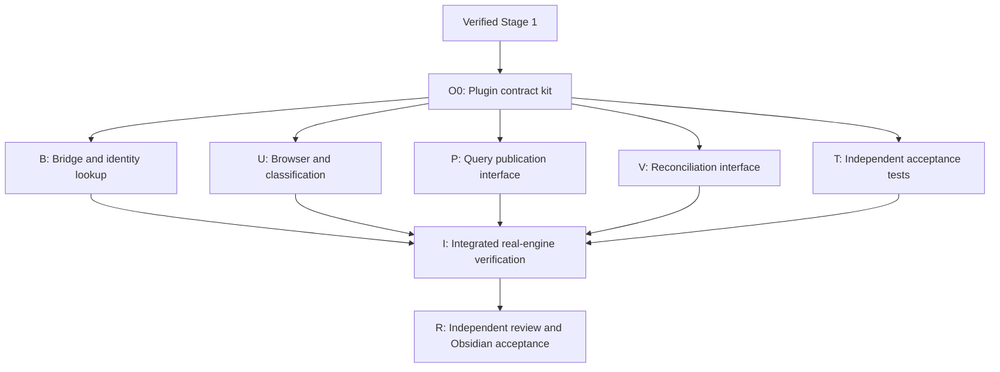

# Owner-defined facets, Stage 2: Obsidian interface

Status: reviewed against verified Stage 1; O0 contract kit implemented, verification in progress.
Remaining Stage 2 tasks have not started.

Date: 2026-10-13.

Product direction: Obsidian first. The standalone Open Brain desktop application is out of scope,
including a later desktop phase within this plan. “Desktop Obsidian” means the existing Obsidian
plugin host, not the separate application in `packages/desktop`.

This specification extends [Stage 1](owner-defined-facets-stage-one.md) and
[ADR 0020](../architecture/decisions/0020-independent-owner-defined-facets.md).
Stage 1 remains authoritative for identity, transactions, authority, publication, reconciliation
and Portable evidence. The interface must not introduce a second classification store.

## Outcome and boundaries

An owner can complete this flow inside the managed Open Brain vault in Obsidian:

**Create vocabulary → classify records → save a query → review and publish a page → reconcile
an explicit Markdown classification edit.**

The interface also exposes classification history and opens existing generated facet indexes.
Records without a managed Markdown file remain searchable, readable and classifiable through
their engine identity. The plugin does not create duplicate notes to make them visible.

Included:

- A dockable facet browser, record classification editor and vocabulary management dialogs.
- A structured saved-query builder and paged results.
- Facet-query publication through the existing proposal/inspection/decision lifecycle.
- Explicit per-record reconciliation previews, apply and conflict feedback.
- Bridge contracts, accessibility, lifecycle handling and real-engine integration tests.

Excluded: standalone desktop application work, Obsidian mobile, arbitrary-vault support, bulk
mutation across records, automatic classification, AI draft generation, OR/NOT/hierarchical queries,
recursive synthesis from canonical pages, conversion of spaces to facets, background services,
new network paths, and changes to Portable formats. No default vocabulary is installed.

## Baseline and dependency gate

Stage 1 passed full repository verification at `abeab52136a668fd851a6d4a7c72aa8fa67baedb`
and independent review of F01–F22. Handoff commit `490bd05609e1cf3046946da1b935096de987d024`
adds the verification receipts and a catalog docstring correction without changing behavior.
See [the Stage 1 audit](../audits/2026-10-13-owner-defined-facets-stage-one-audit.md).
O0 pins that implementation and all schema/catalog digests in
[its task manifest](obsidian-o0-task-manifest.json). Recheck relevant interfaces if those inputs change.

The inspected development contract is `facets-c0-v4`, verified contract commit
`ed74327f34ec2526fd36b1737e36b05bcd2cdc62`, with fixture-manifest SHA-256
`95e85b535eeb4263a6e430970ecf1d49de8d0b72de7425e41be703897d93dbc5`.
These identify source inputs, not a plugin capability negotiation mechanism.

| Existing surface | Reuse and required extension |
|---|---|
| `packages/obsidian-plugin/src/main.ts` | Existing command, modal, managed-vault and publication flows. Register new commands; keep facet UI in dedicated modules. |
| `packages/obsidian-plugin/src/bridge.ts` and `contracts.ts` | Lifecycle-owned stdio child, strict JSON, envelopes and operation types. Add negotiated facet operations and operation-specific bounds. |
| `packages/obsidian-plugin/src/t07-client.ts` | Record reads and publication inspection/decisions. Reuse compatible helpers; extend facet evidence parsing. |
| `packages/app/src/open_brain/services/plugin_bridge.py` | Server-side dispatch, authority and discovery. Facet dispatch is absent at the inspected baseline. |
| `packages/app/src/open_brain/services/facets.py` | Existing parsing, grants, quotas, receipts and transport-aware pagination. Add an explicit plugin transport policy. |
| `packages/app/src/open_brain/services/review_publication.py` | Existing facet proposal inspection and review service. Reuse its engine-backed behavior. |
| `packages/engine/src/open_brain_engine/engine/facet_vault.py` | Existing preview/apply custody and reconciliation. No plugin-side reconciliation algorithm. |

Paths in this document are repository-relative so they resolve in each implementation worktree.

## Interface structure

Use one reusable facet browser with three sections: Browse, Saved queries and Vocabulary.
Keep record assignment, publication review and reconciliation in focused dialogs opened from
that view or the command palette. Do not add a separate application shell.

Register these commands under the existing Open Brain command namespace:

| Command | Behavior |
|---|---|
| Open Brain: Browse facets | Open or focus the facet browser; restore only harmless view preferences. |
| Open Brain: Classify current note | Resolve the managed note through the bridge, then open its assignment editor. |
| Open Brain: Manage facet vocabulary | Open dimensions and values with create, rename and archive actions. |
| Open Brain: Saved facet queries | Open saved queries; run, edit or start publication from a selected query. |
| Open Brain: Review facet edits in current note | Request a fresh reconciliation preview for the resolved record. |

Record result rows also offer Classify, Read, History and, when a verified managed path exists,
Open note. A query offers New page; an attached canonical page offers Update from saved query.
History is reached from a record or vocabulary item, without another top-level command.

Every surface has loading, empty, ready, error and unavailable states. Distinguish “no vocabulary,”
“no matching records” and “this runtime lacks facet support.” Keep unrelated plugin commands
working against older runtimes. Display names as text, never HTML or executable Markdown.

### Vocabulary and assignment

Dimensions and values are owner-defined. Show the dimension with each value; same-named values
in different dimensions remain distinct. The client carries stable IDs and expected versions.
Engine normalization and name uniqueness remain authoritative.

Creation asks for a name, plus a dimension for a value. Rename preserves identity. Archive requires
an explicit confirmation explaining that existing assignments and queries remain, new assignments
are blocked, and Stage 1 has no unarchive. Do not offer delete, merge or move-between-dimensions.

The assignment editor displays current memberships, including archived ones. The owner edits a
local draft and selects Save once. Send one assignment patch with explicit add/remove IDs and
the versions read when editing began. Cancel has no effect. Existing archived memberships can be
kept or removed, but archived choices cannot be added. A source successor keeps the logical
source's classification; the editor must not bind identity to a filename or obsolete capture.

On a stale version or content revision, keep the owner's draft and show the current state beside
the requested changes. Reload and reapply requires a new explicit Save against fresh versions;
never silently overwrite the newer state. The limit is Stage 1's 128 resulting memberships.

### Query builder and browsing

Build selectors using dimension/value pickers and the existing record-type, space and other
Stage 1 filters. Every selected value must match, including multiple values from one dimension.
Show this as “Match all selected values.” Store IDs, not a query string parsed from labels.

Ad hoc browsing does not create a saved query. Save asks for a name. Editing an existing query
uses its current expected version; renaming it does not change its selection. Archive and page
attachment remain explicit actions. Attaching a query to a page does not assign facets to it.

Fetch 50 results per page, with an explicit Load more action and no background prefetch. Keep
at most 500 result summaries in the view; then ask the owner to narrow or restart the query.
Do not imply that the loaded count is the total. A stale cursor offers Restart results and clears
the old continuation only on that action. Never combine pages from different query versions.
Reads use existing record projection; unavailable records reveal no extra identities or counts.

### Publication

Start from a saved query. New-page publication requires an explicitly chosen destination space.
Update requires the canonical page's current revision and its attached query; its destination
stays fixed. Show the page's own assignments separately from its source-selection query.

The editor accepts an owner-written title and Markdown draft. It may offer an empty structured
template; it does not invoke an AI provider. Browsing results is advisory. Proposal creation uses
`review.propose_from_facet_query`, which freezes the complete eligible source set in the engine.
Never send just the visible page of results or silently truncate a selection to 32 sources.
Zero eligible sources or more than 32 requires the owner to change the query.

Inspect the actual proposal before enabling a decision. Show its frozen selected sources and
revisions, destination, target, query selection and relevant facet evidence. Distinguish newly
selected evidence from inherited provenance on updates. Reuse the existing review token and
approve/reject/edit-and-approve contracts; editing draft text does not silently change evidence.

Do not call the existing capture-review helper that routes sources into one space. Facet proposals
may select across spaces and must preserve every source's routing and privacy. On evidence
conflict, retain the draft, explain that the proposal is stale, and require an explicit fresh
proposal and inspection. Reinspection alone cannot repair an obsolete frozen selection.

Approval success is separate from vault refresh/open success. If publication commits but refresh
fails, display “Published; vault refresh needed” and retry refresh only. Do not submit a new
publication to recover a display failure. Wait for the existing managed-file availability check
before opening the note.

### Markdown reconciliation and history

Editing a registered note's `facets` subtree does not apply classification automatically. The
review command calls `facet.vault.preview` and shows each proposed addition and removal, current
classification version, expiry and any conflict. Missing or empty `facets` explicitly shows all
proposed removals. Unknown labels never create vocabulary as a side effect.

Disable Apply while conflicts exist. Explain unknown/ambiguous labels, archived additions,
changed content, changed projection and invalid frontmatter in owner-facing terms. Offer Edit
note or Refresh preview, as appropriate; do not infer a correction or approve a body edit.
Combined body/frontmatter edits must go through the existing content workflow as well.

Apply sends only the preview ID and a stable operation ID. An expired or changed preview requires
a new preview and confirmation. If assignment commits with `refresh_required`, show the receipt
as committed and offer managed refresh. Preserve edited generated indexes and report conflicts.
Unregistered owner `facets` properties are not claimed, stripped or rewritten by this feature.

History uses the engine's classification event sequence and existing history operations. Label it
“Classification history” so it cannot be mistaken for content revisions. History is read-only;
restoring an earlier membership state or unarchiving is outside this interface.

## Bridge and contract requirements

Extend the existing foreground `open-brain plugin` child. No MCP client, shell command per action,
new process manager, HTTP listener or direct SQLite access is introduced. The engine stays
independent of Obsidian and the app package.

### Discovery and authority

Expose the Stage 1 operation names directly through the plugin bridge: `facet.dimension.*`,
`facet.value.*`, `facet.assignment.*`, `facet.query.*`, `facet.history.*`,
`review.propose_from_facet_query`, and owner-local `facet.vault.preview`/`facet.vault.apply`.
Reuse existing `publication.*` inspection and decision operations. Add only implemented methods
to discovery; direct calls must enforce the same capability intersection.

Add `plugin` as an explicit transport policy in the shared facet adapter. Preserve CLI and MCP
rules, including the absence of vault reconciliation from MCP. The normal owner plugin gets
authority from trusted runtime setup. Restricted sessions retain their effective scope and
independent facet/search/history/review grants; no request can assert owner authority. Vault
operations and managed-path resolution remain owner-local. Discovery is not authorization.

Keep the existing bridge envelope/protocol when additions are backward compatible. O0 below
must define an additive negotiated facet capability descriptor, with supported DTO version and
operation limits, and prove old/new client-runtime combinations. Do not use a development fixture
hash as a runtime compatibility decision. Absent or incompatible support disables facet actions
with an upgrade explanation while existing capture/search flows continue.

O0 freezes protocol 1 plus `facet_capabilities: {version: 1, operations: [...]}`. Each closed
entry has `operation`, `dto_versions`, `request_bytes` and `response_bytes`. Negotiate the
intersection of known client operations, ordinary handshake operations and compatible descriptor
entries. Unknown future operations are ignored; an unsupported DTO disables that operation.
Malformed descriptors disable facets. Smaller advertised limits are binding: B must pass the
negotiated limit to outbound admission and inbound buffering, in addition to O0's hard maximum.
The exact codec and descriptor rules are in [the O0 kit](obsidian-plugin-contract-kit.md).

### Managed record resolution

Do not trust editable frontmatter IDs, titles, or generated index filenames to identify records.
Add owner-local bridge operation `workspace.record.resolve` with this closed v1 shape:

```text
request:  {dto_version: 1, workspace_id: string, relative_path: string}
response: {status: "ok", dto_version: 1, workspace_id: string,
           record_id: string, revision_id: string,
           subject: {kind: "source" | "canonical", id: string}}
```

The bridge verifies the configured workspace, pinned root, confined relative path, registered
managed-file identity and current eligibility using engine-managed custody. Reject symlink escape,
wrong workspace, unknown/unregistered files and generated indexes. Return closed errors without
path or inaccessible-identity disclosure. `record_id` is a valid current record anchor for Stage 1;
`subject` is the stable logical source/page identity. A managed file with no proven facet subject
is unavailable for this action; never invent a mapping.

This is a local bridge lookup, not a new engine facet wire operation or a Portable identity.
O0 must verify an existing custody lookup can supply it or define the smallest engine-owned
lookup extension. A code inspection and real managed-file test are prerequisites to its freeze.
For browsing results, use returned record identities directly; Open note requires a separately
verified managed mapping. A missing path does not prevent classification or record reading.

The verified implementation materializes canonical pages in `managed_notes`; it does not have
a trusted source-note mapping. O0 therefore proves canonical resolution and source-file refusal.
The response union preserves source identity for a future proven mapping, but does not advertise
that mapping. Sources remain classifiable through engine record IDs returned by queries.

O0's read-only engine helper requires an explicit managed-workspace observation after the most
recent materialization or atomic file replacement. Setup/refresh alone does not retain the new
inode baseline. Missing or stale observation returns `not_found`; resolution never observes,
accepts content, refreshes or registers metadata. B must expose an explicit safe observation
action or explain the existing `open-brain workspace observe` recovery. Do not silently call
`workspace.reconcile` for this purpose: it also accepts body edits. Protected bytes must match
both accepted managed content and the current eligible canonical revision; only registered facet
metadata may differ. Root, relative path, device/inode/link custody and eligibility are checked.

### Serialization, bounds and retry state

Use the Stage 1 closed schemas and positive/negative examples for TypeScript parsers. Validate
requests and responses, integer grammar, ID prefixes and unknown fields. Update strict-integer
handling for facet operations. Additive facet selection in publication inspection needs an
explicit parser and compatibility tests; do not treat it as an unchecked arbitrary object.

At the inspected baseline both bridge ends impose a blanket 64 KiB request limit, and the client
has a 5 MiB response buffer. Those are not sufficient operation-specific admission. Preserve
existing-operation limits, but permit the Stage 1 1 MiB facet publication request envelope while
ordinary facet requests remain at 65,536 bytes. Implement bounded operation-aware server framing:
read at most the maximum permitted frame, parse strictly, then reject the actual operation's
oversize request before dispatch. Reject unknown operations before effects.

Count actual plugin envelope bytes on both sides. Facet pages stay within 250,000 bytes, mutation
receipts within 4 KiB, and single facet reads within 1 MiB. Use the shared adapter's pre-effect
receipt reservation and immutable engine page-admission hook with the plugin response encoder.
Retain Stage 1 session quotas and shared search/history/review accounting. Test escaped Unicode
and boundary-sized frames. A client-side rejection alone is not proof of server enforcement.

O0 uses UTF-8 JSON plus one LF, including the full protocol envelope and request ID, for every
byte count. Python uses `ensure_ascii=False`; TypeScript uses `JSON.stringify`. B must retain
the engine's existing conservative Portable/ASCII DTO cap as well as the plugin envelope cap
when admitting a page, so non-ASCII data cannot pass page admission and fail serialization.
The pure O0 codecs do not establish bounded live stream reads, quotas or pre-effect reservations.

Generate one operation ID per confirmed mutation. Keep its exact request for an explicit retry
while the plugin session remains loaded. Disable duplicate submissions while pending. A timeout,
child restart or `operation_pending` leaves the result uncertain: offer Retry same operation,
never silently generate another ID. A confirmed conflict followed by edited arguments is a new
operation. Review decisions retain their existing token/idempotency contracts.

No durable mutation queue is added. Closing Obsidian or unloading the plugin discards in-memory
drafts and retry state; explain this before discarding an uncertain write. On reopening, reload
authoritative state/history before enabling a replacement action. Do not persist note content,
tokens, cursors or authority in plugin settings. Persist only harmless view preferences and stable
query IDs, resolving them again under current authority.

## Interaction and lifecycle requirements

All primary actions work from the keyboard. Label inputs and controls, provide visible focus,
return focus after dialogs close, and announce loading/errors without relying only on color or
temporary notices. Archived, pending and conflict states have visible text. Respect the active
Obsidian theme and reduced-motion preference. Keep long source text and evidence readable in
scrollable regions; escape untrusted labels and links.

Render and retain bounded result sets. Superseded asynchronous reads cannot replace a newer
selection or act after a view closes. Closing a view stops UI continuations; unloading the plugin
disposes views, listeners and its owned child. Do not kill the shared bridge merely to cancel one
view's read if another operation is pending. Cancellation after dispatch is not rollback.

Facet file observations may mark a note as needing review, but do not automatically call Apply,
publish, reconcile body edits or repeatedly refresh the entire vault. Use explicit foreground
refresh through the existing recovery mechanism. Ordinary refresh must continue to preserve edits.

## Delivery graph and ownership

O0 is the first implementation milestone. Its ownership and worker pins are recorded in
`obsidian-o0-task-manifest.json`. Remaining tasks require verified O0 before dispatch.
The main implementation coordinator owns registration, shared contracts, integration and the
execution ledger. Reserve exact files and input pins before future dispatch; do not reuse the
Stage 1 worker manifest as if it authorized Stage 2 edits.



| Task | Bounded output and completion gate |
|---|---|
| O0 | Freeze bridge capability/identity/inspection shapes, TS parsers, operation limits and fixture manifest. Prove real identity lookup feasibility. Pin verified Stage 1. |
| B | Bridge facet dispatch, owner-local lookup and wrapped limits. Real stdio tests prove authority, refusal before effects and durable retry behavior. |
| U | Dedicated facet client/view and vocabulary/assignment/query components. Keyboard and state-machine tests pass; real binding is verified at I. |
| P | Dedicated facet publication UI; reusable review inspection/decision integration. No source rerouting; recovery uses existing receipts. |
| V | Dedicated preview/apply UI, conflict and refresh states. Body changes and unregistered metadata remain protected. |
| T | Independent tests derived from the acceptance matrix; missing producers are recorded as unverified rather than mocked success. |
| I / R | Coordinator wires shared files, runs full checks, obtains independent review and records actual Obsidian acceptance. |

Candidate exclusive module groups are `facet-client`/`facet-browser`/`facet-editor` for U,
`facet-publication` for P and `facet-reconciliation` for V, each with separate tests. O0 owns
`facet-wire` and shared fixtures. B can use a dedicated app plugin-facet adapter. The coordinator
serializes changes to `main.ts`, `bridge.ts`, `contracts.ts`, `styles.css`, `t07-client.ts`,
`plugin_bridge.py`, shared facet services and contract/catalog registration. Exact reservations
belong in the future task manifest before implementation, including any newly required engine seam.

UI modules and independent tests can prepare against O0 fixtures while B is built. Integration
requires actual bridge/engine outputs. Mocked UI tests prove interaction and rendering only;
they never prove persistence, authority, publication recovery, reconciliation custody or restore.

## Acceptance matrix

| ID | Required evidence |
|---|---|
| O01 | Older runtime disables only facet features; partial capabilities are reflected in UI and enforced by direct server calls. |
| O02 | Real observed managed canonical pages resolve; source-file mapping is unavailable. Edited IDs, unknown notes, generated indexes, wrong workspace, stale observation, file/root replacement and escaped paths fail before mutation. Record IDs still support classification without a managed file. |
| O03 | Create, rename and archive vocabulary through plugin → stdio → engine; IDs and assignments survive rename and archived additions are refused. |
| O04 | Classify a record with and without a managed file; cancel writes nothing; stale Save preserves the draft and cannot overwrite newer state. |
| O05 | Same-ID retry after a lost mutation response produces one durable change; double-click, child restart and uncertain-result UI preserve retry identity. |
| O06 | Saved/ad hoc queries match all selected values, retain filters, page without omission/duplication, and handle stale cursors without mixed results. |
| O07 | Cross-space facet publication preserves source routing, uses an explicit destination and reviews the actual frozen set; zero/33 matches are refused. |
| O08 | Update preserves destination and cumulative provenance; relevant drift conflicts, and page assignment stays separate from query attachment. |
| O09 | Approval followed by refresh/open failure shows committed publication and recovers without a second publication; rejection creates no published page. |
| O10 | Markdown preview explicitly shows missing-subtree removals; unknown/ambiguous/archive/content/expiry conflicts block Apply without overwriting edits. |
| O11 | Reconciliation retry commits once; refresh failure keeps the receipt; body edits and modified indexes survive. No observation silently applies facets. |
| O12 | Actual plugin wire bounds, quotas, strict parsing and closed errors hold with Unicode and oversized requests; server refusal occurs before effects. |
| O13 | Keyboard, focus, theme and reduced-motion behavior work; stale async results and unload cannot update disposed views or trigger duplicate writes. |
| O14 | Fresh real-engine export/import preserves plugin-created facets, queries and publication evidence; a fresh managed vault rebuilds views and rejects old preview custody. |
| O15 | Complete the owner flow in actual desktop Obsidian with synthetic data; existing capture, search, manual publication and conflict workflows still pass. |

Run focused TypeScript tests with `npm --prefix packages/obsidian-plugin test -- <test-path>` and
`npm --prefix packages/obsidian-plugin run typecheck`. Run the new real Python bridge integration
tests using the repository's frozen environment. O0/T must register their exact test paths before
those commands can count as completed verification.

On the integrated candidate run `make verify`, `git diff --check` and
`actionlint .github/workflows/ci.yml`. If native/package inputs change, also run the repository's
required native audit and Homebrew smoke checks. The existing full gate may run desktop package
regressions; that does not add desktop feature work to this scope.

Record exact candidate and fixture pins with every result. Run packaged plugin/core acceptance
against a synthetic vault in actual Obsidian before calling O15 complete. Unit stubs and browser
screenshots are insufficient for host lifecycle, filesystem watcher and note-opening behavior.
Installation into an owner's real vault, publishing and deployment remain separate actions.

## Draft review and implementation entry

A direct repository-grounded review checked scope, bridge feasibility, authority, retry behavior
and the publication/reconciliation boundaries. It identified and incorporated the missing plugin
dispatch, managed-record lookup, publication request limit, frozen-evidence inspection and
cross-space routing requirements. No independent or multi-agent review was run in this side
conversation, and no Stage 2 runtime verification is claimed.

O0 is the next implementation task after Stage 1's final verified handoff. Its blocking design
checks are the additive capability descriptor and the real custody lookup behind
`workspace.record.resolve`. Resolve them in executable contracts before dispatching UI workers;
report any required engine extension rather than weakening identity or authority checks.
